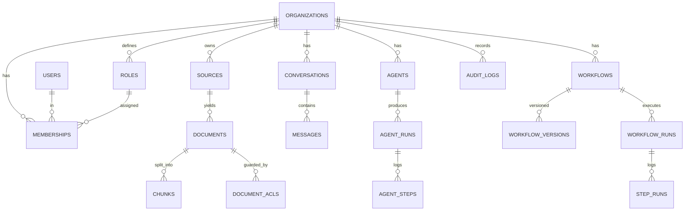

# Helix — Engineering Specification (SPEC.md)

> Authoritative spec for the Helix platform. Claude Code MUST read this file (and `CLAUDE.md`) before making architectural decisions or writing code. Build phase-by-phase per §41. When behavior changes, update this file in the same PR.

**Status:** Design v1 · **Owner:** (you) · **Last updated:** on creation

---

## 1. Product Overview

Helix is a multi-tenant, AI-native enterprise platform that makes an organization's knowledge **searchable, answerable, and actionable**. Users connect data sources; Helix ingests and indexes content under strict permissions; users get hybrid search and a grounded, cited RAG assistant; and power users build tool-using agents and event-driven workflows that automate downstream work. It ships with SSO/RBAC, billing, audit, analytics, observability, and a public API.

Helix is delivered as a **modular monolith** (FastAPI backend + Next.js frontend) that is designed to be decomposed into services later without rewrites.

## 2. Goals

- Grounded, **ACL-aware** RAG: the assistant never surfaces content the user is not permitted to see.
- Strong **multi-tenant isolation** enforced at the application and database layers.
- **Async-first** ingestion and execution via background workers with durable retries.
- An **agent runtime** with tool-calling under hard guardrails, and a **workflow engine** with durable execution.
- Production-grade **security, testing, observability, CI/CD, and cloud deployability**.
- A codebase a single engineer can extend for 6–12+ months, one working slice at a time.

## 3. Non-Goals

- Not building our own foundation models; we consume LLM providers via an abstraction.
- Not a general-purpose BI/warehouse product (analytics here is operational, not a data lake).
- No premature microservices, Kubernetes, or multi-region in early phases.
- Not targeting HIPAA/PCI certification in v1 (design leaves room; certification is later).
- No mobile native apps in v1 (responsive web only).

## 4. Personas

- **Priya — Org Admin/Ops Lead:** configures sources, roles, workflows, billing.
- **Sam — Member/Daily User:** searches, asks the assistant, runs agents.
- **Dana — Developer/Integrator:** uses the public API, builds connectors and agent tools.
- **Alex — Security/Compliance:** reviews audit logs, access, and isolation.

## 5. User Journeys

1. **Onboard:** Priya signs up → creates org → invites Sam → connects Google Drive → content ingests → both search it (scoped to their permissions).
2. **Ask:** Sam opens the assistant, asks a question, receives a streamed answer with citations he can click through to sources he's allowed to see.
3. **Automate (agent):** Priya builds an agent with `search` + `notify` tools that answers a recurring request and posts the result.
4. **Automate (workflow):** Priya builds a workflow: *trigger* = new document in source X → *step* summarize → *step* if matches policy, notify channel Y.
5. **Govern:** Alex reviews the audit log of who accessed what and exports an access report.
6. **Integrate:** Dana creates a scoped API key and drives search + assistant from an external app; subscribes to webhooks.

## 6. Functional Requirements

- **FR-Auth:** email/password (Argon2) + OIDC SSO; JWT access + refresh; MFA optional; session revocation.
- **FR-Org:** create/manage orgs; invite/accept/remove members; switch active org.
- **FR-RBAC:** roles (Owner, Admin, Member, Viewer + custom), permission checks on every endpoint.
- **FR-Docs:** upload/list/delete documents; per-document ACLs; object storage.
- **FR-Ingest:** async extract → chunk → embed → index; status tracking; retries/DLQ; idempotent re-ingest.
- **FR-Search:** hybrid (keyword + vector) search, ACL-filtered, paginated, highlighted.
- **FR-Assistant:** streaming RAG answers with citations; conversation history.
- **FR-AI-Abstraction:** provider-agnostic LLM + embeddings; per-org model config; prompt versioning; eval harness.
- **FR-Agents:** tool registry; bounded tool-calling loop; run traces; guardrails.
- **FR-Workflows:** DAG builder; event/schedule/webhook triggers; durable runs; retries/DLQ; versioning.
- **FR-Connectors:** OAuth connect; incremental sync; source-ACL mapping; ≥2 connectors.
- **FR-Notify:** email + in-app; templates; preferences; digests; delivery tracking.
- **FR-Billing:** plans, seats, usage metering, quotas (Stripe test mode).
- **FR-Analytics/Audit:** immutable-ish audit log; usage/quality analytics; admin dashboards.
- **FR-API:** scoped API keys, rate limits, versioned public subset, signed outbound webhooks.

## 7. Non-Functional Requirements

- **Performance:** p95 search < 400ms (excl. LLM); assistant first token < 2s; ingestion throughput ≥ 50 docs/min/worker (target, tune in §39).
- **Availability:** stateless API + workers, horizontally scalable; graceful degradation if LLM provider is down (search still works).
- **Security:** tenant isolation with zero cross-tenant leakage; ACL-aware retrieval; encryption in transit and at rest; no secrets in code.
- **Reliability:** at-least-once job processing with idempotency; durable workflow runs survive worker restart.
- **Observability:** every request traceable end-to-end; LLM cost/latency tracked.
- **Testability:** critical paths covered; ACL leakage and tenant isolation tested explicitly.
- **Maintainability:** modules communicate via interfaces/events, never by reaching into each other's tables.

## 8. System Architecture

Modular monolith. A FastAPI application composed of **domain modules** (auth, orgs, rbac, documents, ingestion, search, assistant, ai, agents, workflows, connectors, notifications, billing, analytics, audit, api). Shared infrastructure: Postgres+pgvector, Redis (cache + broker), object storage (S3/MinIO), and a worker fleet. An AI layer abstracts LLM/embeddings/rerank and hosts the eval harness. See `ENTERPRISE_PROJECT_GUIDE.md` §6 for diagrams (system, RAG request lifecycle, ingestion, agent loop, workflow engine). Each module owns its tables and exposes an internal service class; cross-module calls go through those services or via domain events on the queue.

## 9. Repository Structure

```
helix/
├── SPEC.md
├── CLAUDE.md
├── docker-compose.yml
├── .env.example
├── .github/workflows/            # CI/CD
├── infra/                        # Dockerfiles, terraform/, grafana/, otel/
├── backend/
│   ├── pyproject.toml
│   ├── alembic/                  # migrations
│   └── app/
│       ├── main.py               # FastAPI app factory
│       ├── core/                 # config, logging, security, db, deps, errors
│       ├── modules/
│       │   ├── auth/             # router.py, service.py, models.py, schemas.py, tests/
│       │   ├── orgs/
│       │   ├── rbac/
│       │   ├── documents/
│       │   ├── ingestion/
│       │   ├── search/
│       │   ├── assistant/
│       │   ├── ai/               # provider abstraction, embeddings, rerank, evals
│       │   ├── agents/
│       │   ├── workflows/
│       │   ├── connectors/
│       │   ├── notifications/
│       │   ├── billing/
│       │   ├── analytics/
│       │   ├── audit/
│       │   └── api/              # public API keys + webhooks
│       ├── workers/              # worker entrypoints, task defs
│       └── tests/                # cross-cutting + integration + e2e
├── frontend/
│   ├── package.json
│   └── src/
│       ├── app/                  # Next.js App Router
│       ├── components/
│       ├── lib/                  # api client, auth, query
│       └── features/             # search, assistant, agents, workflows, admin
└── docs/                         # ADRs, runbooks, this guide
```

Backend and worker share one image with different entrypoints (`app.main` vs `app.workers.run`).

## 10. Database Schema (core)

Tenant-scoped tables carry `org_id` (FK, indexed, RLS-guarded). All tables: `id UUID pk`, `created_at`, `updated_at`, `deleted_at NULL` (soft delete).

- **users**(id, email unique, password_hash, is_active, mfa_secret NULL)
- **organizations**(id, name, slug unique, plan, settings jsonb)
- **memberships**(id, org_id, user_id, role_id, status) — unique(org_id, user_id)
- **roles**(id, org_id NULL for system roles, name, permissions text[])
- **sources**(id, org_id, type, name, config jsonb, status, last_synced_at)
- **documents**(id, org_id, source_id, external_id, title, mime, storage_key, status, checksum)
- **document_acls**(id, org_id, document_id, principal_type, principal_id) — who may see a doc
- **chunks**(id, org_id, document_id, ordinal, content, embedding vector(N), tsv tsvector, acl_hash) — indexes: ivfflat/hnsw on embedding, GIN on tsv, btree on (org_id, document_id)
- **conversations**(id, org_id, user_id, title) / **messages**(id, conversation_id, role, content, citations jsonb, tokens, cost)
- **agents**(id, org_id, name, config jsonb, allowed_tools text[]) / **agent_runs**(id, org_id, agent_id, status, cost, started_at, finished_at) / **agent_steps**(id, run_id, ordinal, type, tool, input jsonb, output jsonb)
- **workflows**(id, org_id, name, status) / **workflow_versions**(id, workflow_id, version, graph jsonb) / **workflow_runs**(id, org_id, workflow_id, version, status, trigger jsonb, context jsonb) / **step_runs**(id, workflow_run_id, node_id, status, attempts, input jsonb, output jsonb, error)
- **notifications**(id, org_id, user_id, channel, template, payload jsonb, status) / **notification_prefs**(id, org_id, user_id, channel, event, enabled)
- **api_keys**(id, org_id, name, prefix, hash, scopes text[], last_used_at) / **webhooks**(id, org_id, url, secret, events text[], active)
- **audit_logs**(id, org_id, actor_id, action, resource_type, resource_id, metadata jsonb, ip, created_at) — append-only
- **usage_events**(id, org_id, kind, quantity, cost, occurred_at) / **subscriptions**(id, org_id, stripe_id, plan, seats, status)
- **jobs**(id, org_id, kind, status, attempts, payload jsonb, error, run_at) — for DLQ visibility

## 11. ER Diagram



## 12. API Specification

REST under `/api/v1`. JSON. Cursor pagination. Standard error envelope `{ "error": { "code", "message", "details" } }`. All tenant endpoints require auth + resolved org context.

Representative endpoints:

- **Auth:** `POST /auth/register`, `POST /auth/login`, `POST /auth/refresh`, `POST /auth/logout`, `GET /auth/me`
- **Orgs:** `POST /orgs`, `GET /orgs`, `POST /orgs/{id}/invitations`, `POST /invitations/{token}/accept`, `GET /orgs/{id}/members`
- **RBAC:** `GET /roles`, `POST /roles`, `PUT /memberships/{id}/role`
- **Documents:** `POST /documents` (multipart), `GET /documents`, `GET /documents/{id}`, `DELETE /documents/{id}`, `POST /documents/{id}/reindex`
- **Search:** `GET /search?q=&limit=&cursor=`
- **Assistant:** `POST /assistant/query` (SSE stream), `GET /conversations`, `GET /conversations/{id}`
- **Agents:** `POST /agents`, `GET /agents`, `POST /agents/{id}/runs`, `GET /agents/{id}/runs/{runId}`
- **Workflows:** `POST /workflows`, `GET /workflows`, `POST /workflows/{id}/versions`, `POST /workflows/{id}/trigger`, `GET /workflows/{id}/runs`
- **Connectors:** `POST /connectors/{type}/connect`, `POST /connectors/{id}/sync`, `GET /connectors/{id}`
- **Notifications:** `GET /notifications`, `PUT /notifications/prefs`
- **Billing:** `GET /billing`, `POST /billing/checkout`, `GET /usage`
- **Audit/Analytics:** `GET /audit`, `GET /analytics/*`
- **Public API keys:** `POST /api-keys`, `GET /api-keys`, `DELETE /api-keys/{id}`; `POST /webhooks`

OpenAPI is auto-generated by FastAPI and treated as a contract for the frontend and SDK.

## 13. Authentication

Argon2id password hashing. JWT access tokens (≤15 min) signed with a rotating key (kid in header); refresh tokens (opaque, stored hashed, rotating, revocable). OIDC/OAuth2 SSO for enterprise. Optional TOTP MFA. Auth endpoints are rate-limited and audited. Passwords never logged. Access tokens carry `sub`, `org_id` (active org), and minimal claims — never full permission sets (resolved server-side).

## 14. Authorization

Every endpoint declares required permission(s) via a FastAPI dependency. Authorization is checked **after** authentication and tenant resolution, **before** business logic. Denials are audited. There is no implicit "admin bypass" — the Owner role simply has all permissions explicitly.

## 15. RBAC

Permissions are fine-grained strings (`documents:read`, `documents:write`, `workflows:manage`, `billing:manage`, `members:invite`, …). Roles map to permission sets. System roles (Owner/Admin/Member/Viewer) are seeded; orgs can define custom roles. A permission check resolves the caller's membership → role → permissions for the active org. RBAC governs **actions**; ACLs (below) govern **data visibility** — both must pass.

## 16. Multi-Tenancy

Shared database, shared schema. Every tenant row has `org_id`. Enforcement is layered: (1) a base repository/query layer auto-applies `org_id` from request context; (2) Postgres **Row-Level Security** policies as defense-in-depth (session variable `app.current_org` set per request/txn); (3) tests assert no query returns cross-tenant rows. Object storage keys are namespaced by `org_id`. Background jobs carry `org_id` in their payload and set the RLS context before running.

## 17. AI Architecture

An `ai` module provides:
- **LLMProvider** interface: `complete()`, `stream()`, `tools()` — implemented for OpenAI, Anthropic, and a local/Ollama option.
- **EmbeddingProvider** interface: `embed(texts) -> vectors`.
- **Reranker** interface (cross-encoder or LLM-based) applied to top-K retrieval.
- **PromptRegistry:** versioned, templated prompts with variables; changes are reviewable in git.
- **Cost/limit guard:** per-request and per-org token/cost caps; degrade gracefully.
- **Eval harness:** offline datasets scoring retrieval (hit-rate/MRR) and answer quality (grounding/faithfulness); runs in CI to catch regressions.

Provider selection is per-org config; nothing else in the codebase imports a provider SDK directly.

## 18. RAG Pipeline

1. **Ingest** (async): extract text + metadata + source ACLs → chunk (size ~500–1000 tokens, overlap) → embed → upsert to pgvector + FTS.
2. **Retrieve:** hybrid — BM25/`ts_rank` over `tsv` + cosine over `embedding`, merged (reciprocal rank fusion), **filtered by the caller's ACL set** (`chunks.acl_hash`/join to `document_acls`), scoped to `org_id`.
3. **Rerank** top-K.
4. **Assemble** context within a token budget; attach citation metadata.
5. **Generate:** stream the answer; enforce "answer only from context, cite sources"; return citations linking to chunks.
6. **Log:** query, retrieved chunk ids, tokens, cost, latency, eval sample.

The ACL filter in step 2 is **mandatory and tested** — an answer must never cite content the user cannot access.

## 19. Agent Architecture

Agents run a bounded tool-calling loop: the LLM either calls a registered tool or returns a final answer. **Tool registry** entries declare name, JSON schema, permission required, and handler. Built-in tools: `search`, `fetch_document`, `http_request` (allowlisted), `notify`, `run_workflow`. **Guardrails** (hard-enforced, not prompt-only): max steps, allowed-tools list, tenant scope on every tool, wall-clock timeout, and cost cap. Every step is persisted (`agent_steps`) for a full replayable trace. Runs are isolated per org and audited. Failures are captured, not swallowed.

## 20. Workflow Engine

A durable, event-driven DAG executor.
- **Definition:** a versioned graph (nodes + edges) stored as jsonb; node types include trigger, action, AI, condition/branch, and notify.
- **Triggers:** events (internal domain events), schedules (cron via scheduler), and inbound webhooks.
- **Execution:** each run is a state machine persisted to `workflow_runs`/`step_runs`. A worker claims a run, executes ready nodes, persists results, and advances. Because state is in Postgres, a crashed worker's run is **resumable** — another worker picks it up (idempotency keys prevent double side-effects).
- **Reliability:** per-step retries with exponential backoff; exhausted steps go to DLQ; runs are replayable from persisted state.
- **Versioning:** editing a workflow creates a new version; in-flight runs keep their version.

This module is intentionally the "hard backend correctness" centerpiece (see roadmap Phase 13).

## 21. Event Architecture

Internal domain events (e.g., `document.ingested`, `workflow.run.completed`) are published to a lightweight event bus (Redis streams / a `domain_events` table + dispatcher). Consumers include workflows (as triggers), notifications, and analytics. Events are the seam along which modules stay decoupled and along which services will later be extracted. Events carry `org_id` and a correlation id.

## 22. Background Jobs

Worker framework: **Arq** (async-native, Redis-backed) — or Celery if you prefer maturity. Separate queues/pools: `ingestion`, `execution` (agents/workflows), `notifications`, `maintenance`. Contract: at-least-once delivery, idempotency keys, bounded retries, dead-letter on exhaustion, and a `jobs` table for visibility. A scheduler (Arq cron / beat) drives periodic syncs, digests, and scheduled workflow triggers. Jobs always set tenant (RLS) context before touching data.

## 23. Notifications

A `notifications` module abstracts channels (email via provider, in-app inbox; SMS/push later). Templated messages, per-user/per-event preferences, batching/digests, and delivery tracking. Notifications are emitted as events by agents, workflows, and system processes — never sent inline in request handlers (always via workers). Unsubscribe/preference compliance is respected.

## 24. Search

Hybrid search over `chunks`: Postgres FTS (`tsvector` + GIN) for lexical, pgvector (HNSW/IVFFlat) for semantic, fused via reciprocal rank fusion, then reranked. Always filtered by `org_id` + ACLs. Returns snippets with highlights and source references. Documented upgrade path: move to OpenSearch/Elasticsearch (lexical) and/or a dedicated vector DB (Qdrant/pgvector-at-scale) if volume demands — behind the existing `SearchService` interface.

## 25. File Processing

Uploads go to object storage; a `documents` record is created with status `pending`. Ingestion workers extract text by mime type (PDF via a parser, HTML, plain text, docx), capture layout/metadata where useful, chunk, embed, and index. Large files are streamed, not loaded whole. Checksums enable idempotent re-ingest. Extraction failures are retried then DLQ'd with a visible status.

## 26. Integrations

A **connector framework** defines a `Connector` interface: `authenticate()`, `list_changes(cursor)`, `fetch(item)`, `map_acls(item)`. Connectors run incremental syncs on a schedule, mapping source permissions into `document_acls` so retrieval stays ACL-aware. v1 ships ≥2 connectors (e.g., Google Drive + GitHub, or generic S3/web). OAuth tokens are stored encrypted. Rate limits and backoff are per-connector.

## 27. Analytics

Operational analytics: usage (queries, tokens, cost, active users), assistant quality (eval scores, thumbs), top queries/gaps, ingestion health, workflow/agent success rates. Backed by `usage_events` + aggregation queries/materialized views. Surfaced in admin dashboards. Not a general BI warehouse (see Non-Goals).

## 28. Audit Logging

Append-only `audit_logs` capture actor, action, resource, metadata, ip, timestamp for every sensitive action (auth, permission changes, data access where required, config/billing changes, agent/workflow executions). Logs are tenant-scoped, queryable/exportable by admins, and never mutated. Consider hash-chaining for tamper evidence (later).

## 29. Security

- Tenant isolation (app layer + RLS) with explicit leakage tests.
- ACL-aware retrieval (never leak content into answers/search).
- Secrets via env/secret manager; never in code or logs; `.env` gitignored; `.env.example` committed.
- Input validation (Pydantic) everywhere; output encoding on frontend.
- **Prompt-injection defenses:** treat retrieved content as untrusted; system/instructions separated from context; tool guardrails independent of model output; allowlist for `http_request`.
- Security headers, CORS lockdown, CSRF handling for cookie flows, rate limiting, dependency + container scanning in CI.
- Encryption in transit (TLS) and at rest (DB/storage); PII minimization and retention policy.
- A written **threat model** (Phase 19) maps each risk to a control and a test.

## 30. Observability

Structured JSON logging with correlation/trace ids; OpenTelemetry traces spanning API → worker → LLM; Prometheus metrics (latency, throughput, queue depth, error rates); Grafana dashboards; Sentry for exceptions. **LLM observability:** per-request tokens, cost, latency, model, and eval scores dashboarded. Health/readiness endpoints for orchestration. Alerts on error rate, queue backlog, DLQ growth, and cost spikes.

## 31. Error Handling

Central exception handlers convert domain/validation/auth errors into the standard envelope with stable `code`s; unexpected errors return 500 with a correlation id (details logged, not leaked). Workers catch, record (`jobs.error`), retry with backoff, and DLQ on exhaustion. The frontend renders typed errors with actionable messages and never white-screens. No error is silently swallowed.

## 32. Testing Strategy

- **Unit:** services, guards, pipeline steps, prompt assembly.
- **Integration:** DB + workers (real Postgres/Redis via compose), ingestion end-to-end, workflow durability (kill-and-resume).
- **Security tests:** tenant isolation, **ACL leakage** (must be zero), authz matrix, prompt-injection cases.
- **AI evals:** retrieval + answer quality on fixed datasets, gating regressions in CI.
- **E2E:** Playwright for core user journeys.
- **Load:** k6/Locust baselines for search, assistant, ingestion.
- Coverage focus on critical paths, not a vanity percentage. Tests ship **with** features, never after.

## 33. CI/CD

GitHub Actions: on PR → lint (ruff/eslint), type-check (mypy/tsc), unit+integration tests (with service containers), build images, dependency + container scan, run AI evals. On merge to `main` → build/push image, run migrations against staging, deploy to staging. Production deploy is a gated manual approval. Branch protection requires green CI + review. Tag `phase-N-complete` at each Definition of Done.

## 34. Docker Setup

One backend image (entrypoint switch for api vs worker vs scheduler). `docker-compose.yml` for local: `api`, `worker`, `scheduler`, `postgres` (with pgvector), `redis`, `minio`, `frontend`, plus optional `otel-collector`/`grafana`. Multi-stage Dockerfiles; non-root runtime user; healthchecks; `.dockerignore`. Compose is the single command to run the whole system locally.

## 35. Local Development

`cp .env.example .env` → `docker compose up` boots everything. Backend hot-reload; frontend `next dev`. `make` targets (or `just`): `make up`, `make test`, `make migrate`, `make lint`, `make seed`. A seed script creates a demo org, users, roles, and sample documents so any phase is demoable in under a minute.

## 36. Production Deployment

Container platform (Fly.io/Render early; ECS/Fargate or GKE later) with managed Postgres (pgvector), managed Redis, and S3-compatible storage. Secrets via the platform's secret store. Migrations run as a pre-deploy step. Zero-downtime rolling deploys; separate staging and prod. IaC via Terraform (Phase 22). TLS termination at the ingress; WAF/rate limiting at the edge.

## 37. Database Migrations

Alembic. Every schema change is a reversible migration, reviewed in the PR that needs it. Migrations run in CI (up + down) and as a deploy step. Rules: additive-first (add columns/tables before switching reads/writes), backfill in background jobs, never destructive without a two-step (deprecate → drop) across releases. No manual production schema edits.

## 38. Backup & Recovery

Automated daily Postgres backups + point-in-time recovery (managed provider). Object storage versioning enabled. Documented, periodically **tested** restore runbook (a backup you've never restored is a hope, not a backup). Redis is treated as ephemeral (cache/queue) — durable state lives in Postgres/S3. RPO/RTO targets recorded in `docs/runbooks`.

## 39. Performance Strategy

Indexes for every hot query (composite `org_id` indexes, GIN on `tsv`, HNSW on embeddings); connection pooling; caching (Redis) for hot reads and permission resolution; pagination everywhere; stream large responses; batch embeddings; async I/O throughout. Measure before optimizing (traces + load tests). Retrieval tuning: chunk size, top-K, reranker depth balanced against latency/cost.

## 40. Scalability Strategy

Stateless API + workers scale horizontally behind a load balancer. Queue-based backpressure isolates spikes. Postgres read replicas for read-heavy analytics/search; table partitioning for `chunks`/`audit_logs`/`usage_events` as they grow. Per-tenant rate limits and cost caps prevent noisy-neighbor issues. Service extraction path (ingestion → runtime → search) per `ENTERPRISE_PROJECT_GUIDE.md` §6.9 when a single bottleneck justifies it — not before.

## 41. Development Roadmap

Phases 0–23 as defined in `ENTERPRISE_PROJECT_GUIDE.md` §8 (Phase 0 setup → 23 performance). This SPEC is the source of truth for each phase's details; the guide is the sequencing. **Every phase must leave the app working and demoable, with tests, and a git tag at its Definition of Done.** Do not begin a phase before the prior phase's DoD is met.

## 42. Acceptance Criteria (per phase — pattern)

A phase is accepted when: its functional requirements are implemented; its acceptance test (named in the phase) passes locally and in CI; tenant isolation and (where relevant) ACL tests pass; migrations run up and down; the feature is demoable via the seeded environment; and docs (`SPEC.md`/ADRs) reflect any behavior change. Global always-on acceptance gates: no cross-tenant leakage, no ACL leakage, no secrets in code, CI green.

## 43. Definition of Done

For any change: code + tests written and passing; lint + type-check clean; migrations reversible and applied; authz + tenant scoping enforced on new endpoints; no secrets committed; observability (logs/metrics) added for new critical paths; docs updated; commits focused; PR reviewed; app still boots via `docker compose up` and the seeded demo still works.

## 44. Claude Code Development Instructions

Full operating rules live in `CLAUDE.md`. Summary: read `SPEC.md` + `CLAUDE.md` before architectural decisions; understand existing code before modifying; work one roadmap phase at a time; plan before coding and wait for approval; never restructure the repo or delete working functionality without justification; write and run tests with every change; use migrations; never hardcode secrets; always enforce auth, RBAC, tenant isolation, and ACL-aware retrieval; document decisions as ADRs; keep commits focused; avoid unnecessary dependencies and premature microservices.
