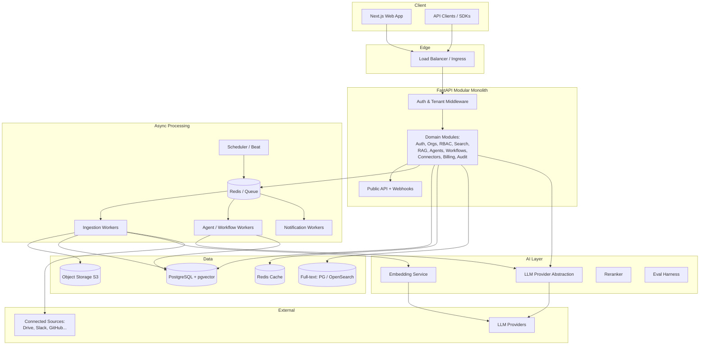
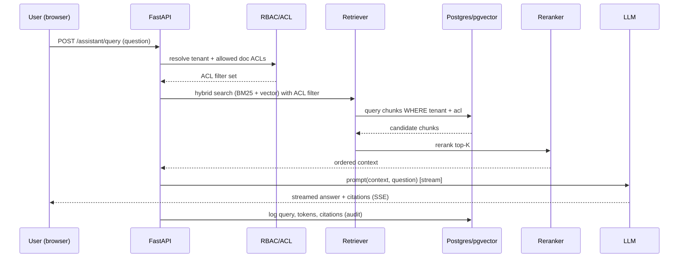
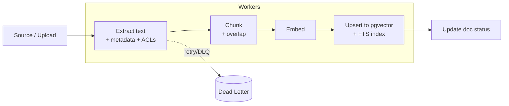
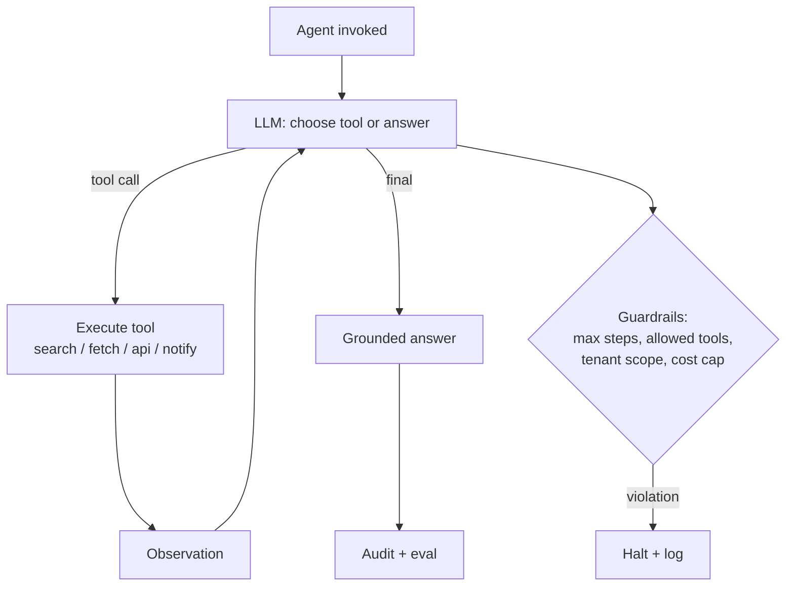
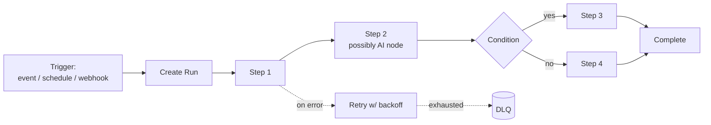

# Enterprise-Grade Project Selection & Design Guide

> Prepared as if by a Principal Architect / CTO advising a single engineer who will build a genuinely large system in VS Code using Claude Code as the primary assistant. This document covers idea generation, ranking, selection, architecture, roadmap, and the exact way to drive Claude Code. The full engineering spec lives in the companion `SPEC.md`, and the agent guardrails live in `CLAUDE.md`.

**Assumptions I'm making (stated so you can override them):**

- You are one developer with strong general programming ability, comfortable in Python and TypeScript or willing to become so.
- Your goal is depth and interview signal, not shipping to paying customers next month.
- You want something you can work on for 6–12 months and never run out of meaningful work.
- You will use PostgreSQL, Docker, and a cloud target (AWS/GCP/Fly/Render) eventually.
- "Buildable by one person with Claude Code" is a hard constraint — nothing here needs a team of 20 to reach a working state.

If any of those are wrong, tell me and I'll re-tilt the recommendation.

---

## PHASE 1 — 25+ Enterprise Project Ideas

Each idea is deliberately scoped to be *months* of work. Difficulty is 1–10 where 10 = "needs a specialized team." I've kept everything at 7–9: hard enough to be real, sane enough for one person + Claude Code.

---

### 1. Helix — AI-Native Enterprise Knowledge & Workflow Automation Platform

1. **Name:** Helix
2. **One-line:** Connect your company's documents and tools, get semantic search + a grounded RAG assistant, then build AI agents and event-driven workflows on top.
3. **Problem it solves:** Enterprise knowledge is scattered across Drive, Confluence, Slack, tickets, and PDFs; people can't find answers and can't automate the follow-up work.
4. **Target users:** Mid-market and enterprise ops, support, IT, and internal-tools teams; also a self-hostable product for regulated companies.
5. **Why enterprise-grade:** Multi-tenant, RBAC, audit, SSO, connectors, background ingestion, vector search, agentic automation, billing — the full SaaS control plane.
6. **Major modules:** Auth/SSO, Orgs & tenancy, RBAC, Connectors/ingestion, Document processing, Search, RAG assistant, Agent runtime (tool calling), Workflow engine, Notifications, Analytics, Audit, Billing, Admin, Public API.
7. **AI opportunities:** Embeddings + hybrid RAG, agent tool-calling, workflow-node "AI steps," summarization, semantic routing, eval harness, guardrails.
8. **Backend complexity:** Very high — async ingestion pipelines, chunking, embeddings, vector + relational stores, queue-based workers, provider abstraction.
9. **Frontend complexity:** High — search UI, chat with streaming + citations, visual workflow builder, admin, dashboards.
10. **Infra complexity:** High — Postgres + pgvector, Redis, object storage, worker fleet, message queue, observability.
11. **Security:** Tenant isolation, per-document ACLs that survive into retrieval, secrets management, PII handling, prompt-injection defense.
12. **Scalability:** Horizontal workers, sharded ingestion, read replicas, cache layers, per-tenant rate limits.
13. **Technical challenges:** ACL-aware retrieval, incremental re-indexing, agent reliability/evals, streaming with citations, connector rate limits.
14. **Difficulty:** 9
15. **Scope:** 8–12+ months of continuous meaningful work.
16. **What you learn:** RAG at production quality, agent orchestration, multi-tenant SaaS, async systems, evals, the whole platform stack.
17. **Resume value:** Extremely high — it *is* the current market (Glean/enterprise-copilot category) and touches every buzzword honestly.
18. **Future features:** Connector marketplace, agent marketplace, fine-tuned rerankers, on-prem deployment, SOC2 workflows.

---

### 2. Argus — AI-Assisted Incident Management & On-Call Platform

1. **Name:** Argus
2. **One-line:** PagerDuty-style alerting + incident timelines with an AI copilot that summarizes, drafts postmortems, and suggests remediations.
3. **Problem:** Incidents are chaotic; context is lost; postmortems are painful; on-call is miserable.
4. **Target users:** SRE / DevOps / platform teams at any company running production software.
5. **Why enterprise-grade:** Real-time alert ingestion, escalation policies, schedules, SLAs, audit, integrations with monitoring tools.
6. **Modules:** Alert ingestion, Dedup/grouping, Escalation & schedules, Incident timeline, AI copilot, Runbooks, Postmortems, Analytics, Integrations, Notifications.
7. **AI:** Alert clustering, incident summarization, RAG over runbooks/past incidents, remediation suggestions, auto-postmortem drafts.
8. **Backend:** High — high-throughput event ingestion, dedup windows, stateful escalations, timers.
9. **Frontend:** High — real-time incident view, timeline, on-call calendar, live updates.
10. **Infra:** High — queues, schedulers, websockets, time-series storage.
11. **Security:** Sensitive alert data, webhook signature verification, RBAC.
12. **Scalability:** Bursty alert storms, backpressure, idempotency.
13. **Challenges:** Alert dedup/correlation, reliable escalation timers, exactly-once-ish notifications.
14. **Difficulty:** 8
15. **Scope:** 6–9 months.
16. **Learn:** Event-driven systems, real-time UX, scheduling, reliability engineering.
17. **Resume:** Very high for infra/SRE/platform roles.
18. **Future:** Auto-remediation actions, chatops, dependency-aware blast-radius.

---

### 3. Ledgerline — Multi-Tenant FinOps / Cloud Cost & Usage Platform

1. **Name:** Ledgerline
2. **One-line:** Ingest cloud billing + usage data, allocate costs by team/tenant, forecast spend, and get AI-driven savings recommendations.
3. **Problem:** Cloud bills are opaque; nobody knows who's spending what or how to cut it.
4. **Target users:** FinOps, engineering leadership, platform teams.
5. **Why enterprise-grade:** Large data ingestion (CUR files), tag-based allocation, chargeback/showback, forecasting, anomaly detection.
6. **Modules:** Billing ingestion, Normalization, Allocation engine, Budgets/alerts, Forecasting, Anomaly detection, Recommendations, Dashboards, Reports.
7. **AI:** Anomaly detection, spend forecasting, NL-to-query ("why did EC2 spike?"), savings recommendations.
8. **Backend:** Very high — big ETL, columnar analytics, aggregation.
9. **Frontend:** High — analytics dashboards, drill-downs, cohort views.
10. **Infra:** High — data warehouse/OLAP (DuckDB/ClickHouse), batch pipelines, object storage.
11. **Security:** Financial data, tenant isolation, read-only cloud credentials.
12. **Scalability:** GBs of billing data, partitioned tables, materialized views.
13. **Challenges:** Cost allocation logic, forecasting accuracy, anomaly tuning.
14. **Difficulty:** 8
15. **Scope:** 6–9 months.
16. **Learn:** Data engineering, OLAP, forecasting, analytics UIs.
17. **Resume:** High for data/platform/FinOps-adjacent roles.
18. **Future:** Multi-cloud, k8s cost, unit economics, RI/savings-plan optimization.

---

### 4. Sentinel — Cloud Security Posture & Compliance Automation (CSPM)

1. **Name:** Sentinel
2. **One-line:** Continuously scan cloud accounts for misconfigurations, map findings to compliance frameworks, and automate evidence collection.
3. **Problem:** Security/compliance posture is manual, point-in-time, and audit prep is brutal.
4. **Target users:** Security engineers, GRC teams, startups pursuing SOC2/ISO.
5. **Why enterprise-grade:** Policy-as-code engine, framework mapping, evidence, remediation, multi-account.
6. **Modules:** Cloud connectors, Asset inventory, Policy engine, Findings, Compliance mapping, Evidence, Remediation, Reporting.
7. **AI:** Finding triage/prioritization, NL policy authoring, remediation explanation, control gap analysis.
8. **Backend:** Very high — scanners, policy evaluation (OPA/Rego-style), graph of resources.
9. **Frontend:** High — findings triage, compliance dashboards, evidence views.
10. **Infra:** High — scheduled scans, workers, secrets, graph store.
11. **Security:** This *is* the security product — least-privilege scanning, secrets, tenant isolation.
12. **Scalability:** Thousands of resources per account, incremental scans.
13. **Challenges:** Policy engine design, resource graph, framework mapping.
14. **Difficulty:** 9
15. **Scope:** 8–10 months.
16. **Learn:** Cloud security, policy engines, graph modeling, compliance.
17. **Resume:** Very high for security roles.
18. **Future:** IaC scanning, drift detection, auto-remediation PRs.

---

### 5. Cortex — Enterprise Feature Flag & Experimentation Platform

1. **Name:** Cortex
2. **One-line:** LaunchDarkly-style flags + A/B experimentation with a stats engine and targeting rules.
3. **Problem:** Teams ship risky releases and can't measure impact or roll back safely.
4. **Target users:** Product & platform engineering teams.
5. **Why enterprise-grade:** Low-latency flag evaluation SDK, targeting rules, experiment stats, audit, multi-env.
6. **Modules:** Flag management, Targeting engine, SDK/edge eval, Experiments, Stats engine, Audit, Analytics, SDKs.
7. **AI:** Experiment result summarization, anomaly detection on metrics, auto-rollout guardrails.
8. **Backend:** High — low-latency evaluation, streaming config, stats.
9. **Frontend:** High — rule builder, experiment dashboards.
10. **Infra:** High — edge caching, streaming updates (SSE), analytics store.
11. **Security:** SDK keys, env isolation, audit.
12. **Scalability:** Millions of flag evals/sec conceptually; caching + CDN patterns.
13. **Challenges:** Real-time config propagation, statistically valid experiments.
14. **Difficulty:** 8
15. **Scope:** 6–8 months.
16. **Learn:** Low-latency systems, streaming, statistics, SDK design.
17. **Resume:** High for platform/backend roles.
18. **Future:** Multi-armed bandits, feature lifecycle, holdouts.

---

### 6. Flowforge — Visual Workflow / Integration Automation Platform (Zapier-class)

1. **Name:** Flowforge
2. **One-line:** Build event-triggered, multi-step automations across apps with a visual builder, retries, and AI steps.
3. **Problem:** Business teams need automation but can't code; existing tools are pricey and closed.
4. **Target users:** Ops teams, RevOps, internal tooling teams.
5. **Why enterprise-grade:** Durable workflow execution, retries, connectors, versioning, multi-tenant.
6. **Modules:** Trigger system, Connector framework, Workflow engine (DAG), Execution runtime, Retries/DLQ, Secrets, Versioning, Monitoring.
7. **AI:** AI action nodes (classify/extract/generate), NL-to-workflow, error explanation.
8. **Backend:** Very high — durable execution, idempotency, scheduling.
9. **Frontend:** Very high — node-graph builder, run inspector.
10. **Infra:** High — queues, workers, state store, secrets.
11. **Security:** Third-party creds, sandboxed execution, tenant isolation.
12. **Scalability:** Many concurrent workflows, backpressure.
13. **Challenges:** Durable execution semantics, connector abstraction, replay.
14. **Difficulty:** 9
15. **Scope:** 8–12 months.
16. **Learn:** Durable workflows (Temporal-style), DAG engines, connector design.
17. **Resume:** Very high — workflow engines are hard and respected.
18. **Future:** Marketplace, self-hosted runners, human-in-the-loop steps.

---

### 7. Scholar — AI Document Intelligence & Contract Lifecycle Platform

1. **Name:** Scholar
2. **One-line:** Upload contracts/documents, auto-extract clauses and obligations, ask questions, track renewals and risk.
3. **Problem:** Legal/finance teams drown in documents; obligations and deadlines slip.
4. **Target users:** Legal ops, procurement, finance.
5. **Why enterprise-grade:** OCR + layout parsing, clause extraction, obligation tracking, approvals, audit.
6. **Modules:** Ingestion/OCR, Extraction, Clause library, Q&A (RAG), Obligations/renewals, Approvals, Audit, Reporting.
7. **AI:** Layout-aware extraction, clause classification, RAG Q&A, risk scoring, redlining suggestions.
8. **Backend:** High — document pipelines, extraction models, structured storage.
9. **Frontend:** High — document viewer with overlays, clause navigation.
10. **Infra:** High — OCR workers, object storage, vector store.
11. **Security:** Highly sensitive docs, encryption, access controls, audit.
12. **Scalability:** Large docs, batch processing.
13. **Challenges:** Accurate extraction, grounding, document viewer UX.
14. **Difficulty:** 8
15. **Scope:** 7–10 months.
16. **Learn:** Document AI, OCR pipelines, extraction, RAG.
17. **Resume:** High — document-AI is a hot vertical.
18. **Future:** E-signature, obligation calendars, negotiation copilot.

---

### 8. Pulse — Real-Time Analytics & Event Data Platform

1. **Name:** Pulse
2. **One-line:** Ingest product events, build funnels/retention/dashboards, and query with SQL and natural language.
3. **Problem:** Teams need product analytics (Amplitude/Mixpanel-class) but want ownership and flexibility.
4. **Target users:** Product, growth, data teams.
5. **Why enterprise-grade:** High-ingest pipeline, columnar store, query engine, dashboards, cohorts.
6. **Modules:** Event ingestion SDK, Schema/registry, Storage (OLAP), Query engine, Funnels/retention, Dashboards, Alerts.
7. **AI:** NL-to-SQL, anomaly detection, auto-insights, cohort explanation.
8. **Backend:** Very high — ingestion at volume, OLAP, query layer.
9. **Frontend:** Very high — chart builder, funnels, dashboards.
10. **Infra:** Very high — Kafka/queue, ClickHouse/DuckDB, batch + stream.
11. **Security:** PII handling, tenant isolation, data retention.
12. **Scalability:** This is the whole point — high write throughput, partitioning.
13. **Challenges:** Ingestion reliability, query performance, funnel math.
14. **Difficulty:** 9
15. **Scope:** 8–12 months.
16. **Learn:** Data-intensive systems, OLAP, streaming, analytics UX.
17. **Resume:** Very high for data platform roles.
18. **Future:** Session replay, warehouse-native mode, reverse ETL.

---

### 9. Forge — Internal Developer Platform (IDP) / Self-Service Infra Portal

1. **Name:** Forge
2. **One-line:** A Backstage-style portal where devs self-serve services, environments, and infra via golden paths.
3. **Problem:** Devs wait on platform teams; infra is inconsistent; there's no service catalog.
4. **Target users:** Platform engineering, developer experience teams.
5. **Why enterprise-grade:** Service catalog, scaffolding, environment provisioning, RBAC, plugins.
6. **Modules:** Service catalog, Software templates, Env provisioning, CI/CD integration, Scorecards, Docs, Plugins.
7. **AI:** Docs Q&A, template generation, incident/service summarization, config review.
8. **Backend:** High — catalog graph, provisioning orchestration, integrations.
9. **Frontend:** High — catalog, plugin surfaces, scorecards.
10. **Infra:** Very high — k8s, IaC, provisioning workers.
11. **Security:** Least-privilege provisioning, RBAC, secrets.
12. **Scalability:** Many services/teams, catalog sync.
13. **Challenges:** Provisioning orchestration, plugin architecture.
14. **Difficulty:** 9
15. **Scope:** 8–12 months.
16. **Learn:** Platform engineering, k8s, IaC, plugin systems.
17. **Resume:** Very high for platform/DevOps roles.
18. **Future:** Cost/scorecards, drift detection, golden-path marketplace.

---

### 10. Beacon — Customer Support Automation & AI Agent Desk

1. **Name:** Beacon
2. **One-line:** Omnichannel ticketing with an AI agent that resolves tickets using your knowledge base and tools, escalating to humans when needed.
3. **Problem:** Support is expensive and slow; AI can deflect and assist.
4. **Target users:** Support orgs, SaaS companies.
5. **Why enterprise-grade:** Multichannel intake, SLAs, routing, RAG, agent tools, analytics.
6. **Modules:** Inbox/channels, Routing, KB/RAG, AI agent, Macros, SLAs, CSAT, Analytics, Integrations.
7. **AI:** RAG answers, agent tool-calling (refunds/lookups), sentiment, summarization, QA scoring.
8. **Backend:** High — ticketing, routing, SLA timers, agent runtime.
9. **Frontend:** High — agent inbox, chat, admin.
10. **Infra:** High — queues, workers, websockets.
11. **Security:** Customer PII, RBAC, action guardrails.
12. **Scalability:** Ticket volume, concurrent chats.
13. **Challenges:** Reliable agent actions, human handoff, deflection metrics.
14. **Difficulty:** 8
15. **Scope:** 7–10 months.
16. **Learn:** Agentic AI, ticketing systems, real-time UX.
17. **Resume:** Very high — AI support is a huge market.
18. **Future:** Voice, proactive support, agent evals/QA.

---

### 11. Vault — Secrets & Access Management / PAM Platform

1. **Name:** Vault (working name)
2. **One-line:** Store secrets, broker short-lived credentials, and audit privileged access with approvals.
3. **Problem:** Secrets sprawl; standing access is a breach risk.
4. **Target users:** Security, platform, infra teams.
5. **Why enterprise-grade:** Encryption, dynamic secrets, access requests, approvals, full audit.
6. **Modules:** Secret store, Encryption/KMS, Dynamic secrets, Access requests, Approvals, Audit, Policies.
7. **AI:** Access anomaly detection, policy suggestions, audit summarization.
8. **Backend:** Very high — crypto, leasing, revocation, policy engine.
9. **Frontend:** Medium-High — request/approval flows, audit views.
10. **Infra:** High — KMS, HA store, workers.
11. **Security:** This is the core — envelope encryption, key rotation, zero-trust.
12. **Scalability:** High-read secret access, caching.
13. **Challenges:** Crypto done right, lease/revoke, JIT access.
14. **Difficulty:** 9
15. **Scope:** 8–10 months.
16. **Learn:** Applied cryptography, zero-trust, policy engines.
17. **Resume:** Very high for security roles (also risky if crypto is wrong — great learning).
18. **Future:** SSH/DB brokering, session recording, break-glass.

---

### 12. Atlas — Multi-Tenant B2B CRM + Revenue Intelligence

1. **Name:** Atlas
2. **One-line:** A CRM core plus AI revenue intelligence: pipeline, activity capture, forecasting, and deal risk scoring.
3. **Problem:** Sales data is messy; forecasts are guesses; reps waste time on data entry.
4. **Target users:** Sales orgs, RevOps.
5. **Why enterprise-grade:** Complex data model, permissions, automation, forecasting, integrations.
6. **Modules:** Contacts/accounts/deals, Activity capture, Pipeline, Forecasting, Scoring, Automation, Reporting, Integrations.
7. **AI:** Deal risk scoring, next-best-action, email drafting, call summarization, forecast.
8. **Backend:** High — flexible data model, permissions, automation engine.
9. **Frontend:** Very high — data grids, pipeline boards, dashboards.
10. **Infra:** High — sync workers, search, analytics.
11. **Security:** Territory-based access control (hard!), field-level permissions.
12. **Scalability:** Large record counts, reporting.
13. **Challenges:** Flexible/custom fields, complex authorization, forecasting.
14. **Difficulty:** 8
15. **Scope:** 8–12 months.
16. **Learn:** Complex authz, flexible schemas, analytics.
17. **Resume:** High — CRM depth is respected in B2B SaaS.
18. **Future:** Custom objects, workflow automation, conversation intelligence.

---

### 13. Relay — Event Streaming & Webhook Delivery Infrastructure

1. **Name:** Relay
2. **One-line:** A reliable webhook/event delivery platform: ingest events, fan out to subscribers, retry, and give consumers a portal.
3. **Problem:** Everyone rebuilds webhook delivery badly; it's a hard reliability problem.
4. **Target users:** API-first companies, platform teams.
5. **Why enterprise-grade:** At-least-once delivery, retries, DLQ, signing, subscriber portal.
6. **Modules:** Event ingest, Subscription mgmt, Delivery engine, Retries/DLQ, Signing, Consumer portal, Observability.
7. **AI:** Failure pattern detection, payload anomaly detection, log summarization.
8. **Backend:** Very high — delivery guarantees, retries, idempotency, ordering.
9. **Frontend:** Medium-High — subscriber portal, delivery logs.
10. **Infra:** Very high — queues, workers, rate limiting.
11. **Security:** HMAC signing, replay protection, tenant isolation.
12. **Scalability:** High throughput, fan-out, backpressure.
13. **Challenges:** Delivery semantics, retry/backoff, ordering, poison messages.
14. **Difficulty:** 8
15. **Scope:** 6–8 months.
16. **Learn:** Distributed messaging, reliability, idempotency.
17. **Resume:** Very high for backend/infra roles.
18. **Future:** Transformations, filtering, replay UI, streaming subscriptions.

---

### 14. Mosaic — Headless CMS + Digital Asset Platform

1. **Name:** Mosaic
2. **One-line:** Structured content modeling, versioning, localization, and a media pipeline with an AI content assistant.
3. **Problem:** Content teams need flexible, API-first content with governance.
4. **Target users:** Content, marketing, product teams.
5. **Why enterprise-grade:** Schema builder, versioning, localization, roles, publishing workflow, CDN.
6. **Modules:** Content modeling, Editor, Versioning, Localization, Media/DAM, Publishing, API/CDN, Roles.
7. **AI:** Content generation, translation, alt-text, tagging, semantic asset search.
8. **Backend:** High — dynamic schemas, versioning, publishing.
9. **Frontend:** Very high — schema-driven editor, media library.
10. **Infra:** High — object storage, image pipeline, CDN, search.
11. **Security:** Roles, publishing approvals, tenant isolation.
12. **Scalability:** Read-heavy delivery, caching, CDN.
13. **Challenges:** Dynamic schemas, versioning, image pipeline.
14. **Difficulty:** 8
15. **Scope:** 7–9 months.
16. **Learn:** Dynamic schemas, media pipelines, CDN, i18n.
17. **Resume:** High for full-stack roles.
18. **Future:** Visual page builder, personalization, edge delivery.

---

### 15. Meridian — Healthcare Data Interoperability & Care Coordination (FHIR)

1. **Name:** Meridian
2. **One-line:** A FHIR-based platform to ingest, normalize, and coordinate patient data with an AI clinical summarizer.
3. **Problem:** Health data is fragmented across systems; coordination is manual.
4. **Target users:** Health systems, digital-health startups, care teams.
5. **Why enterprise-grade:** FHIR modeling, HIPAA, consent, audit, interoperability.
6. **Modules:** FHIR store, Ingestion/mapping, Patient 360, Care plans, Tasks, Consent, Audit, Reporting.
7. **AI:** Clinical note summarization, risk stratification, coding suggestions (with heavy guardrails).
8. **Backend:** Very high — FHIR resources, terminology, mapping.
9. **Frontend:** High — patient timeline, care plans.
10. **Infra:** High — secure storage, workers, audit.
11. **Security:** HIPAA-grade — encryption, consent, break-glass, audit (highest bar here).
12. **Scalability:** Large clinical datasets, query performance.
13. **Challenges:** FHIR complexity, PHI handling, terminology.
14. **Difficulty:** 9
15. **Scope:** 9–12 months.
16. **Learn:** Healthcare interop, compliance, data modeling.
17. **Resume:** Very high for health-tech (compliance signal is rare and valued).
18. **Future:** SMART-on-FHIR apps, HL7v2, payer integrations.

---

### 16. Cargo — Logistics / Supply-Chain Orchestration & Visibility Platform

1. **Name:** Cargo
2. **One-line:** Track shipments, orchestrate multi-carrier logistics, and predict delays with an optimization engine.
3. **Problem:** Supply chains are opaque; delays cascade; routing is manual.
4. **Target users:** Logistics/ops teams, 3PLs, e-commerce ops.
5. **Why enterprise-grade:** Real-time tracking, carrier integrations, optimization, SLAs.
6. **Modules:** Shipments, Carrier connectors, Tracking, Routing/optimization, Exceptions, Notifications, Analytics.
7. **AI:** ETA prediction, delay/anomaly detection, route optimization, exception triage.
8. **Backend:** Very high — real-time state, integrations, optimization.
9. **Frontend:** High — maps, shipment boards, exception queues.
10. **Infra:** High — event ingestion, geospatial, workers.
11. **Security:** Partner data isolation, API keys.
12. **Scalability:** Many shipments/events, geospatial queries.
13. **Challenges:** Optimization algorithms, real-time state, geospatial.
14. **Difficulty:** 8
15. **Scope:** 8–10 months.
16. **Learn:** Optimization, geospatial, real-time systems.
17. **Resume:** High for logistics/ops-tech.
18. **Future:** Carrier marketplace, capacity planning, digital freight.

---

### 17. Canvas — Real-Time Collaborative Document / Whiteboard Platform (CRDT)

1. **Name:** Canvas
2. **One-line:** Google-Docs/Figma-class real-time collaboration with CRDT conflict resolution, presence, and comments.
3. **Problem:** Real-time collaboration is genuinely hard and most teams can't build it.
4. **Target users:** Product teams building collaborative apps; also a standalone tool.
5. **Why enterprise-grade:** CRDTs, presence, offline sync, permissions, versioning.
6. **Modules:** Doc engine (CRDT), Sync server, Presence, Comments, Permissions, Version history, Export.
7. **AI:** Writing assistant, summarization, semantic search, meeting-notes generation.
8. **Backend:** Very high — CRDT sync, websockets, persistence.
9. **Frontend:** Very high — rich editor, cursors, offline.
10. **Infra:** High — websocket fleet, presence, storage.
11. **Security:** Doc-level permissions, sharing, tenant isolation.
12. **Scalability:** Many concurrent editors, fan-out.
13. **Challenges:** CRDT correctness, offline sync, presence at scale.
14. **Difficulty:** 9
15. **Scope:** 8–12 months.
16. **Learn:** CRDTs, real-time sync, rich editors — rare, high-signal skills.
17. **Resume:** Very high — collaborative editing is elite backend/frontend signal.
18. **Future:** Whiteboard, embeds, plugins, AI co-editing.

---

### 18. Sparrow — Multi-Tenant Notification & Messaging Infrastructure

1. **Name:** Sparrow
2. **One-line:** A notification platform: one API, many channels (email/SMS/push/in-app), templates, preferences, and delivery analytics.
3. **Problem:** Every product rebuilds notifications; preferences, batching, and deliverability are hard.
4. **Target users:** Product/platform teams.
5. **Why enterprise-grade:** Multi-channel routing, templating, preferences, throttling, analytics.
6. **Modules:** Notification API, Templates, Channel providers, Preferences, Batching/digest, Delivery tracking, Analytics.
7. **AI:** Send-time optimization, content personalization, channel selection, copy generation.
8. **Backend:** High — routing, provider abstraction, throttling, batching.
9. **Frontend:** Medium-High — template editor, preference center, analytics.
10. **Infra:** High — queues, workers, provider failover.
11. **Security:** PII, per-tenant keys, unsubscribe compliance.
12. **Scalability:** High-volume sends, rate limits, provider quotas.
13. **Challenges:** Deliverability, batching/digests, preference logic.
14. **Difficulty:** 7
15. **Scope:** 5–7 months.
16. **Learn:** Provider abstraction, queues, deliverability.
17. **Resume:** High for backend/platform roles; also a great *first* large project.
18. **Future:** Workflows/journeys, in-app inbox, A/B on messaging.

---

### 19. Quill — AI Research & Knowledge Synthesis Workbench

1. **Name:** Quill
2. **One-line:** Ingest papers/reports/URLs, build a knowledge graph, run multi-agent research, and produce cited briefs.
3. **Problem:** Research/analysis is slow; synthesis across many sources is manual.
4. **Target users:** Analysts, researchers, consultants, strategy teams.
5. **Why enterprise-grade:** Ingestion, knowledge graph, multi-agent orchestration, citations, collaboration.
6. **Modules:** Ingestion, Knowledge graph, Search/RAG, Multi-agent research, Brief builder, Citations, Collaboration.
7. **AI:** Multi-agent planning, RAG, knowledge-graph extraction, verification/eval, citation grounding.
8. **Backend:** Very high — agents, graph store, async pipelines.
9. **Frontend:** High — research workspace, graph viz, doc editor.
10. **Infra:** High — vector + graph store, workers, LLM orchestration.
11. **Security:** Source access controls, tenant isolation.
12. **Scalability:** Large corpora, concurrent agents.
13. **Challenges:** Agent reliability, grounding/hallucination control, graph extraction.
14. **Difficulty:** 9
15. **Scope:** 8–12 months.
16. **Learn:** Multi-agent systems, knowledge graphs, RAG, evals.
17. **Resume:** Very high — agentic AI is the frontier.
18. **Future:** Autonomous monitoring, report scheduling, domain packs.

---

### 20. Gatekeeper — API Gateway & Developer Platform / Monetization

1. **Name:** Gatekeeper
2. **One-line:** An API management layer: auth, rate limiting, quotas, usage metering, billing, and a developer portal.
3. **Problem:** API-first companies need to secure, meter, and monetize their APIs.
4. **Target users:** Platform teams, API product companies.
5. **Why enterprise-grade:** Gateway proxy, keys, rate limiting, metering, billing, portal.
6. **Modules:** Gateway/proxy, Auth/keys, Rate limiting, Quotas/metering, Billing, Dev portal, Analytics, Docs.
7. **AI:** Usage anomaly detection, docs Q&A, spec-to-SDK, abuse detection.
8. **Backend:** Very high — low-latency proxy, distributed rate limiting, metering.
9. **Frontend:** High — dev portal, dashboards, key management.
10. **Infra:** Very high — edge proxy, Redis, streaming usage.
11. **Security:** Core concern — key management, abuse, isolation.
12. **Scalability:** Proxy throughput, distributed counters.
13. **Challenges:** Distributed rate limiting, accurate metering, low latency.
14. **Difficulty:** 8
15. **Scope:** 7–9 months.
16. **Learn:** Proxies, distributed rate limiting, metering/billing.
17. **Resume:** Very high for backend/platform roles.
18. **Future:** GraphQL support, monetization plans, partner ecosystem.

---

### 21. Northstar — OKR / Strategy Execution & Performance Platform

1. **Name:** Northstar
2. **One-line:** Set OKRs, connect them to live metrics, run check-ins, and get AI-generated progress narratives.
3. **Problem:** Strategy execution is disconnected from data; status updates are manual theater.
4. **Target users:** Leadership, chiefs of staff, ops.
5. **Why enterprise-grade:** Org hierarchy, metric integrations, alignment graph, reviews, permissions.
6. **Modules:** Objectives/KRs, Alignment graph, Metric connectors, Check-ins, Reviews, Dashboards, Notifications.
7. **AI:** Progress narratives, risk detection, alignment suggestions, meeting summaries.
8. **Backend:** High — hierarchy/graph, metric ingestion, permissions.
9. **Frontend:** High — alignment trees, dashboards, review flows.
10. **Infra:** Medium-High — connectors, workers, cache.
11. **Security:** Org-hierarchy-aware access control.
12. **Scalability:** Large orgs, metric refresh.
13. **Challenges:** Alignment graph, hierarchy authz, metric sync.
14. **Difficulty:** 7
15. **Scope:** 6–8 months.
16. **Learn:** Graph modeling, hierarchical authz, integrations.
17. **Resume:** Medium-High; good if you want product-y B2B SaaS depth.
18. **Future:** Scenario planning, capacity, portfolio management.

---

### 22. Tempo — Workforce Scheduling & Field Operations Platform

1. **Name:** Tempo
2. **One-line:** Constraint-based shift scheduling, time tracking, and dispatch with an optimization engine.
3. **Problem:** Scheduling shift workers under constraints is a genuinely hard optimization problem.
4. **Target users:** Retail, healthcare, field-service, hospitality ops.
5. **Why enterprise-grade:** Constraint solving, labor rules, real-time dispatch, mobile, compliance.
6. **Modules:** Scheduling engine, Constraints/rules, Time tracking, Dispatch, Mobile, Compliance, Analytics.
7. **AI:** Demand forecasting, schedule optimization, no-show prediction, NL scheduling.
8. **Backend:** Very high — constraint solver, real-time state.
9. **Frontend:** Very high — schedule grid, drag-drop, mobile.
10. **Infra:** High — solvers, workers, real-time.
11. **Security:** Labor data, roles, PII.
12. **Scalability:** Large workforces, solver performance.
13. **Challenges:** Constraint optimization, labor law rules, real-time.
14. **Difficulty:** 8
15. **Scope:** 8–10 months.
16. **Learn:** Constraint programming, optimization, real-time UX.
17. **Resume:** High — optimization is rare, respected signal.
18. **Future:** Auto-scheduling, marketplace shifts, payroll integration.

---

### 23. Prism — Data Governance, Catalog & Lineage Platform

1. **Name:** Prism
2. **One-line:** Catalog data assets, track column-level lineage, classify sensitive data, and enforce access policies.
3. **Problem:** Companies don't know what data they have, where it flows, or who can see it.
4. **Target users:** Data teams, governance, security.
5. **Why enterprise-grade:** Metadata harvesting, lineage graph, classification, policy enforcement, audit.
6. **Modules:** Metadata connectors, Catalog, Lineage graph, Classification, Access policies, Glossary, Audit.
7. **AI:** Auto-classification (PII/PHI), semantic search, lineage summarization, doc generation.
8. **Backend:** Very high — metadata parsing, graph store, policy engine.
9. **Frontend:** High — catalog search, lineage graph viz.
10. **Infra:** High — connectors, graph DB, workers.
11. **Security:** Sensitive-data classification, policy enforcement.
12. **Scalability:** Huge metadata graphs, incremental harvest.
13. **Challenges:** Column-level lineage (parsing SQL!), graph scale.
14. **Difficulty:** 9
15. **Scope:** 8–12 months.
16. **Learn:** SQL parsing/lineage, graph modeling, governance.
17. **Resume:** Very high for data platform/governance roles.
18. **Future:** Active metadata, data contracts, quality monitoring.

---

### 24. Forecast — Supply/Demand Planning & Inventory Optimization

1. **Name:** Forecast
2. **One-line:** Demand forecasting + inventory optimization + replenishment planning with scenario simulation.
3. **Problem:** Inventory is either too high (cost) or too low (stockouts); planning is spreadsheet-driven.
4. **Target users:** Retail/CPG/manufacturing supply-chain planners.
5. **Why enterprise-grade:** Forecasting, optimization, multi-echelon, scenarios, integrations.
6. **Modules:** Data ingestion, Forecasting, Inventory optimization, Replenishment, Scenarios, Dashboards.
7. **AI:** Time-series forecasting, anomaly detection, NL scenario queries, explanation.
8. **Backend:** Very high — forecasting pipelines, optimization, big data.
9. **Frontend:** High — planning grids, scenario UI, dashboards.
10. **Infra:** High — batch pipelines, compute jobs, OLAP.
11. **Security:** Business-sensitive data, tenant isolation.
12. **Scalability:** Many SKUs × locations × time.
13. **Challenges:** Forecasting accuracy, optimization at scale.
14. **Difficulty:** 8
15. **Scope:** 8–10 months.
16. **Learn:** Time-series ML, optimization, planning systems.
17. **Resume:** High for data/ML + domain roles.
18. **Future:** S&OP, promotions modeling, supplier collaboration.

---

### 25. Sift — Fraud Detection & Risk Decisioning Platform

1. **Name:** Sift
2. **One-line:** Real-time risk scoring with a rules engine, ML models, case management, and a decisioning API.
3. **Problem:** Fraud/risk decisions need to be fast, explainable, and adjustable.
4. **Target users:** FinTech, marketplaces, payments, trust & safety.
5. **Why enterprise-grade:** Low-latency decisioning, rules + ML, case review, audit, feature store.
6. **Modules:** Decisioning API, Rules engine, Feature store, ML scoring, Case management, Lists, Audit, Analytics.
7. **AI:** Anomaly/fraud models, graph-based ring detection, rule suggestion, case summarization.
8. **Backend:** Very high — low-latency scoring, feature store, streaming.
9. **Frontend:** High — case review, rule builder, dashboards.
10. **Infra:** Very high — streaming, feature store, model serving.
11. **Security:** Financial/PII data, audit, tamper-evidence.
12. **Scalability:** Real-time at volume, feature freshness.
13. **Challenges:** Feature store, low-latency scoring, explainability.
14. **Difficulty:** 9
15. **Scope:** 8–12 months.
16. **Learn:** Real-time ML, feature stores, rules engines, streaming.
17. **Resume:** Very high for FinTech/ML-platform roles.
18. **Future:** Graph fraud, model registry, adaptive rules.

---

### 26. Compass — Learning & Skills Development Platform (Enterprise LXP)

1. **Name:** Compass
2. **One-line:** An enterprise learning platform with adaptive paths, skills graph, and an AI tutor grounded in company content.
3. **Problem:** Corporate L&D is generic; skills tracking is nonexistent; content is stale.
4. **Target users:** L&D, People teams, enterprises.
5. **Why enterprise-grade:** Content authoring, skills graph, adaptive paths, SCORM/xAPI, reporting.
6. **Modules:** Authoring, Course engine, Skills graph, Adaptive paths, AI tutor, Assessments, Reporting.
7. **AI:** AI tutor (RAG), content generation, adaptive recommendations, auto-assessment.
8. **Backend:** High — content model, progress tracking, recommendations.
9. **Frontend:** Very high — authoring, player, dashboards.
10. **Infra:** High — media, workers, search.
11. **Security:** Roles, content access, PII.
12. **Scalability:** Many learners, media delivery.
13. **Challenges:** Adaptive path logic, skills graph, authoring UX.
14. **Difficulty:** 7
15. **Scope:** 7–9 months.
16. **Learn:** Content systems, recommendations, RAG tutoring.
17. **Resume:** Medium-High; strong if you like product breadth.
18. **Future:** Cohorts, certifications, marketplace, mentoring.

---

### 27. Anchor — ESG / Carbon Accounting & Reporting Platform

1. **Name:** Anchor
2. **One-line:** Collect activity data, calculate emissions across scopes, and produce audit-ready sustainability reports.
3. **Problem:** ESG reporting is manual, error-prone, and increasingly regulated.
4. **Target users:** Sustainability teams, CFOs, compliance.
5. **Why enterprise-grade:** Data collection, emission factors, methodology, audit trail, disclosure frameworks.
6. **Modules:** Data collection, Emission factors, Calculation engine, Scopes 1/2/3, Reporting, Audit, Targets.
7. **AI:** Invoice/data extraction, factor matching, anomaly detection, report drafting.
8. **Backend:** High — calculation engine, factor DB, provenance.
9. **Frontend:** High — data entry, dashboards, report builder.
10. **Infra:** Medium-High — pipelines, workers, storage.
11. **Security:** Auditability, provenance, tenant isolation.
12. **Scalability:** Many data points, supply-chain scope 3.
13. **Challenges:** Methodology correctness, data provenance, factor matching.
14. **Difficulty:** 7
15. **Scope:** 6–9 months.
16. **Learn:** Calculation engines, provenance, compliance reporting.
17. **Resume:** Medium-High; differentiated and increasingly in demand.
18. **Future:** Supplier portals, scenario/target modeling, assurance workflows.

---

*(That's 27 — comfortably past 25, and every one is a multi-month build.)*

---

## PHASE 2 — Categorization

Several projects legitimately span categories; I've placed each under its dominant one.

**AI Platforms & Agentic Systems**
- #1 Helix (AI knowledge/workflow)
- #10 Beacon (AI support desk)
- #19 Quill (multi-agent research)
- #7 Scholar (document intelligence)

**Developer Tools & Platform Engineering**
- #9 Forge (internal developer platform)
- #5 Cortex (feature flags/experiments)
- #20 Gatekeeper (API gateway/monetization)
- #13 Relay (webhook/event delivery)

**Enterprise SaaS / Operations**
- #12 Atlas (CRM + revenue intelligence)
- #21 Northstar (OKR/strategy)
- #26 Compass (enterprise learning)
- #6 Flowforge (workflow automation)

**FinTech & Financial Operations**
- #3 Ledgerline (cloud FinOps)
- #25 Sift (fraud/risk decisioning)

**Cybersecurity & Access**
- #4 Sentinel (cloud security posture)
- #11 Vault (secrets/PAM)

**Healthcare Technology**
- #15 Meridian (FHIR interoperability)

**Logistics & Supply Chain**
- #16 Cargo (logistics orchestration)
- #24 Forecast (demand/inventory planning)
- #22 Tempo (workforce scheduling — ops/logistics adjacent)

**Data Platforms & Analytics**
- #8 Pulse (product/event analytics)
- #23 Prism (data governance/lineage)

**Cloud Infrastructure & Reliability**
- #2 Argus (incident management/on-call)
- #18 Sparrow (notification infrastructure)

**Collaboration & Content**
- #17 Canvas (real-time collaborative editor)
- #14 Mosaic (headless CMS/DAM)

**Sustainability / GRC**
- #27 Anchor (ESG/carbon accounting)

---

## PHASE 3 — Ranking (Top 10)

I scored every project across the eleven dimensions you named (1–10 each), weighting nothing yet — the "Overall" is the mean, rounded to one decimal. I deliberately favored projects that are (a) buildable solo with Claude Code, (b) deep enough for a year, and (c) strong interview signal. Pure-crypto (#11 Vault) and HIPAA-grade (#15 Meridian) are fascinating but carry correctness/compliance risk that makes them worse *first* mega-projects, so they don't top the list despite high raw complexity.

Legend: TD=Technical Depth, ER=Enterprise Realism, AI=AI Potential, BE=Backend, FE=Frontend, Scal=Scalability, Sec=Security, Ops=DevOps, Port=Portfolio, Intv=Interview, Ext=Extensibility.

| Rank | Project | TD | ER | AI | BE | FE | Scal | Sec | Ops | Port | Intv | Ext | **Overall** |
|------|---------|----|----|----|----|----|------|-----|-----|------|------|-----|-------------|
| 1 | **#1 Helix** (AI Knowledge/Workflow) | 10 | 10 | 10 | 10 | 9 | 9 | 9 | 9 | 10 | 10 | 10 | **9.6** |
| 2 | **#6 Flowforge** (Workflow Automation) | 10 | 9 | 8 | 10 | 10 | 9 | 8 | 9 | 9 | 10 | 10 | **9.3** |
| 3 | **#8 Pulse** (Analytics Platform) | 10 | 9 | 8 | 10 | 9 | 10 | 8 | 9 | 9 | 9 | 9 | **9.1** |
| 4 | **#10 Beacon** (AI Support Desk) | 9 | 10 | 10 | 9 | 9 | 8 | 8 | 8 | 9 | 10 | 9 | **9.0** |
| 5 | **#2 Argus** (Incident Management) | 9 | 9 | 8 | 10 | 9 | 9 | 8 | 10 | 9 | 9 | 9 | **9.0** |
| 6 | **#19 Quill** (Multi-Agent Research) | 10 | 8 | 10 | 9 | 8 | 8 | 7 | 8 | 9 | 10 | 10 | **8.8** |
| 7 | **#4 Sentinel** (Cloud Security) | 9 | 10 | 8 | 10 | 8 | 8 | 10 | 9 | 8 | 9 | 9 | **8.9** |
| 8 | **#20 Gatekeeper** (API Gateway) | 9 | 9 | 7 | 10 | 8 | 10 | 9 | 9 | 8 | 9 | 9 | **8.8** |
| 9 | **#23 Prism** (Data Governance/Lineage) | 10 | 9 | 8 | 10 | 8 | 8 | 8 | 8 | 8 | 9 | 9 | **8.6** |
| 10 | **#17 Canvas** (Collaborative Editor) | 10 | 8 | 7 | 10 | 10 | 8 | 7 | 7 | 9 | 9 | 9 | **8.5** |

**Why the top projects rank highly**

- **#1 Helix** wins because it is the only project that legitimately exercises *every single requirement on your list at once* — RAG, agents, tool-calling, multi-tenancy, RBAC, async workers, search, workflow, billing, observability — while still being buildable in vertical slices where each slice is independently useful. It's also the category the market is hiring for right now (enterprise copilots / knowledge platforms), so the interview story writes itself.
- **#6 Flowforge** ranks second on pure engineering respect: durable workflow execution is one of the hardest correctness problems in backend engineering, and being able to talk credibly about idempotency, retries, and replay is elite signal. It's slightly narrower on the AI axis.
- **#8 Pulse** is the best "data-intensive systems" showcase — if your target roles are data-platform/backend-heavy, it's the strongest, but its frontend and AI stories are a notch below Helix.
- **#10 Beacon** and **#19 Quill** are the most *AI-forward*; they're excellent if you want the résumé to scream "agentic AI," but they concentrate risk in agent reliability, which is the least deterministic thing to build and demo.
- **#2 Argus** and **#4 Sentinel** are the strongest *infra/SRE* and *security* plays respectively; pick these if those are your target job families.

---

## PHASE 4 — Top 3 Recommendations & Final Pick

### Top 3 to seriously consider

#### A. #1 Helix — AI-Native Knowledge & Workflow Platform *(my recommendation)*

- **What you'd build:** A multi-tenant SaaS where an org connects data sources (upload + connectors), the system ingests and embeds content into an ACL-aware index, users get semantic + keyword search and a streaming RAG assistant with citations, and power users build AI agents (tool-calling) and event-driven workflows that automate downstream work. Around it: SSO/RBAC, billing, audit, analytics, admin, and a public API.
- **Architecture shape:** Modular monolith (FastAPI) + Next.js frontend + Postgres/pgvector + Redis + object storage + a worker fleet (Celery/Arq) behind a queue, with an LLM provider abstraction and an evals harness. Evolves into microservices by extracting the ingestion pipeline and agent runtime first.
- **What makes it hard:** ACL-aware retrieval (permissions must survive into the vector search), incremental re-indexing, agent reliability + evals, streaming responses with grounded citations, and multi-tenant isolation everywhere.
- **What you learn:** Production RAG, agent orchestration/tool-calling, async pipelines, multi-tenant SaaS, evals, and the full platform control plane.
- **What it can become:** A real self-hostable enterprise copilot; a connector marketplace; a vertical (legal/support/ops) copilot.
- **Who values it:** Basically every AI-forward company (the enterprise-copilot category), plus any B2B SaaS hiring senior full-stack/platform engineers.

#### B. #6 Flowforge — Workflow Automation Engine

- **What you'd build:** A durable, event-triggered automation platform — visual DAG builder, connector framework, an execution runtime with retries/DLQ/replay, versioning, secrets, and AI action nodes.
- **Architecture shape:** FastAPI + a durable-execution core (either Temporal, or a hand-rolled state-machine engine on Postgres + Redis for maximum learning) + Next.js node-graph builder + workers.
- **What makes it hard:** Durable execution semantics — exactly-once-ish, idempotency, replay after crash, backpressure. This is the deepest *pure backend correctness* project here.
- **What you learn:** Workflow engines, distributed reliability, connector design, node-graph UIs.
- **What it can become:** An internal automation platform or an open-source Zapier alternative.
- **Who values it:** Platform/backend-heavy orgs; extremely strong signal for senior backend roles.

#### C. #8 Pulse — Real-Time Analytics Platform

- **What you'd build:** An event ingestion SDK + high-throughput pipeline + columnar store (ClickHouse/DuckDB) + a query engine powering funnels, retention, and dashboards, with NL-to-SQL and anomaly detection.
- **Architecture shape:** FastAPI ingest + Kafka/Redpanda (or Redis Streams to start) + ClickHouse + Next.js dashboarding + query service.
- **What makes it hard:** Ingestion reliability at volume, query performance, and correct funnel/retention math.
- **What you learn:** Data-intensive systems, OLAP, streaming, analytics UX — the "systems" résumé.
- **What it can become:** A self-hosted product-analytics tool.
- **Who values it:** Data-platform and infra-heavy companies.

### Final recommendation: **#1 Helix**

I'm choosing Helix not because it's the flashiest, but because it uniquely satisfies your *entire* constraint set at once and degrades gracefully. Every requirement you listed — AI, auth/authz, databases, async, APIs, background workers, security, testing, Docker, CI/CD, observability, cloud, scale — maps to a concrete Helix module you can build in a self-contained slice. Flowforge and Pulse are each *deeper in one axis* (backend correctness; data systems) but *narrower* overall — you'd end up bolting AI or auth on artificially. Helix lets you go as deep as you want in any direction (you can even build a Flowforge-grade workflow engine *inside* Helix as one module, and a Pulse-grade analytics module as another) without ever leaving one coherent product.

Just as important for your stated goal — an interview narrative and months of runway — Helix gives you a single sentence that is true and impressive: *"I designed and built a multi-tenant, AI-native enterprise platform from architecture through cloud deployment, including ACL-aware RAG, an agent runtime with tool-calling, an event-driven workflow engine, and full observability."* That sentence opens a dozen deep-dive conversations, and you'll have real code behind every clause.

The rest of this document, plus `SPEC.md` and `CLAUDE.md`, designs Helix in full.

---

## PHASE 5 — Product Overview (Helix)

**Product name:** Helix

**Vision:** Give every team a single place where their organization's knowledge is searchable, answerable, and *actionable* — you find the answer, then let an agent or workflow do the follow-up work, all under enterprise-grade permissions and audit.

**Problem:** Organizational knowledge is fragmented across docs, wikis, tickets, chat, and files. People waste hours searching, answers are stale, and even once you have an answer the follow-up work is manual. Existing tools either search (but don't act) or automate (but don't understand your content).

**Target users / personas:**

- **Priya — Ops Lead (primary buyer/admin):** Connects sources, sets up permissions, builds workflows that automate repetitive ops.
- **Sam — Support/IC (primary daily user):** Asks the assistant grounded questions, uses agents to draft responses and take actions.
- **Dana — Developer/Integrator:** Uses the public API and builds custom connectors and agent tools.
- **Alex — Security/Compliance:** Cares about tenant isolation, audit logs, data residency, and access reviews.

**Core use cases:**

1. Ask a natural-language question and get a cited, grounded answer scoped to what the user is allowed to see.
2. Search across all connected content with hybrid (keyword + semantic) ranking and permission filtering.
3. Build an agent with tools (search, fetch record, call API, send message) that resolves a task end-to-end.
4. Build an event-triggered workflow (e.g., "when a new document matches X, summarize it and notify channel Y").
5. Admin: manage org, members, roles, connectors, billing, and audit.

**Business model possibilities:** Per-seat SaaS + usage-based AI metering; self-hosted enterprise tier; connector/agent marketplace revenue share.

**Competitive positioning:** Sits between horizontal enterprise search (Glean) and automation (Zapier/n8n) and copilots — differentiated by combining ACL-aware RAG *with* an agent/workflow layer in one self-hostable platform.

---

## PHASE 6 — Architecture (Helix)

### 6.1 System architecture (modular monolith to start)



### 6.2 Request lifecycle: a RAG query



### 6.3 Ingestion pipeline (async)



### 6.4 Agent runtime (tool-calling loop)



### 6.5 Workflow engine (event-driven DAG)



### 6.6 Authentication & authorization architecture

- **AuthN:** JWT access tokens (short-lived) + refresh tokens; password (Argon2) + OAuth/OIDC for SSO; optional MFA. Sessions tracked for revocation.
- **AuthZ:** Two layers. (1) **RBAC** — roles (Owner, Admin, Member, Viewer + custom) grant permissions on resources. (2) **ACL-aware data access** — every ingested chunk carries source ACLs; retrieval filters by the caller's effective permissions so the assistant can never surface content the user can't see. This ACL-in-retrieval requirement is *the* defining security constraint.
- **Multi-tenancy:** Shared-database, shared-schema with a mandatory `org_id` on every tenant-scoped row, enforced by a base query layer + Postgres Row-Level Security as defense-in-depth. Every request resolves a tenant context in middleware; no query runs without it.

### 6.7 Data, caching, queues, storage, search

- **Postgres** for all relational data + **pgvector** for embeddings (start here; extract to a dedicated vector DB only if scale demands).
- **Redis** for cache, rate limiting, and as the queue broker (Arq/Celery). Message queue semantics: at-least-once with idempotency keys.
- **Object storage (S3/MinIO)** for raw files and large artifacts.
- **Search:** Postgres FTS (`tsvector`) + pgvector hybrid to start; OpenSearch is the documented upgrade path.
- **Background workers:** separate pools for ingestion (CPU/IO heavy), agent/workflow execution (LLM-bound), and notifications.

### 6.8 Observability & deployment

- **Observability:** structured JSON logs (correlation/trace IDs), OpenTelemetry traces, Prometheus metrics, Grafana dashboards, Sentry for errors, and an LLM-specific layer (token/cost/latency per request, eval scores).
- **Deployment:** Docker + Docker Compose for local; a single container image for the API and workers (same image, different entrypoints); GitHub Actions for CI/CD; deploy to a container platform (Fly.io/Render to start, ECS/Fargate or GKE later) with managed Postgres + Redis + S3.

### 6.9 How it evolves to microservices

Start as a **modular monolith** with clean module boundaries (each domain module owns its tables and exposes an internal service interface, never reaching into another module's tables directly). When a specific bottleneck appears, extract in this order: (1) **Ingestion pipeline** → its own service (heaviest, most independent); (2) **Agent/Workflow runtime** → its own service (scales on LLM load); (3) **Search/retrieval** → its own service if you adopt OpenSearch/dedicated vector DB. Because modules already communicate through interfaces and events, extraction is a deployment change, not a rewrite. Resist doing this early — premature microservices are the single most common way solo mega-projects die.

---

## PHASE 8 — Claude Code Implementation Phases

Each phase leaves the app **working and demoable**. Do not start a phase until the previous one's Definition of Done is met. `SPEC.md` carries the authoritative detail; this is the sequencing.

> Rule of thumb: one phase ≈ 1–4 weeks of solo evenings/weekends. Ship a git tag at each phase boundary.

**Phase 0 — Repository & architecture setup**
- *Objective:* Monorepo scaffold, tooling, CI skeleton, `SPEC.md`/`CLAUDE.md` in place.
- *Prereqs:* none.
- *Features:* repo structure, `docker-compose` with Postgres+Redis+MinIO, linting/formatting/type-checking, pre-commit, empty CI pipeline, `/health` endpoint.
- *DB:* none yet (migration tooling installed).
- *APIs:* `GET /health`.
- *Frontend:* Next.js app boots, hits `/health`.
- *Tests:* one backend + one frontend smoke test running in CI.
- *DoD:* `docker compose up` boots everything; CI is green; health check passes end-to-end.

**Phase 1 — Backend foundation**
- *Objective:* App skeleton with config, DB session, error handling, logging, OpenAPI.
- *Features:* settings via env, structured logging + request IDs, exception handlers, base response envelope, migration workflow (Alembic).
- *DB:* migrations infrastructure; a trivial table to prove it.
- *APIs:* versioned `/api/v1` router, standardized errors.
- *Tests:* config loading, error handler, migration up/down.
- *DoD:* clean layered structure; migrations run in CI; logs are structured.

**Phase 2 — Database & core models**
- *Objective:* Core tenant-agnostic + tenant models and RLS.
- *Features:* `User`, `Organization`, `Membership`, base mixins (id/uuid, timestamps, `org_id`), soft-delete, RLS policies.
- *DB:* schema + migrations for the above; RLS enabled.
- *Tests:* tenant isolation tests (queries can't cross `org_id`).
- *DoD:* isolation proven by tests; migrations reversible.

**Phase 3 — Authentication**
- *Objective:* Signup/login/refresh/logout with secure tokens.
- *Features:* Argon2 passwords, JWT access + refresh, session/revocation, `/auth/*` endpoints, rate limiting on auth.
- *APIs:* register, login, refresh, logout, me.
- *Frontend:* auth pages, token handling, protected routes.
- *Tests:* auth flows, token expiry/refresh, brute-force limits.
- *DoD:* a user can sign up, log in, and hit a protected route; tokens rotate.

**Phase 4 — Organizations & membership**
- *Objective:* Multi-tenant org lifecycle.
- *Features:* create org, invite members (email token), accept invite, switch org, member list.
- *APIs:* org CRUD, invitations, membership.
- *Frontend:* org switcher, members page, invite flow.
- *Tests:* invite lifecycle, tenant context resolution.
- *DoD:* a user creates an org, invites another, both see only their org's data.

**Phase 5 — RBAC & authorization**
- *Objective:* Roles/permissions enforced everywhere.
- *Features:* role model, permission checks (decorator/dependency), Owner/Admin/Member/Viewer, permission middleware, audit of authz decisions.
- *APIs:* role assignment; every existing endpoint gains permission checks.
- *Frontend:* hide/disable by permission.
- *Tests:* permission matrix tests.
- *DoD:* no endpoint is reachable without an explicit permission check.

**Phase 6 — Documents & object storage**
- *Objective:* Upload and manage source documents with ACLs.
- *Features:* file upload to S3/MinIO, document + source models, per-document ACL model, listing, deletion (soft).
- *DB:* `Source`, `Document`, `DocumentACL`.
- *APIs:* upload, list, get, delete.
- *Frontend:* upload UI, document list.
- *Tests:* upload, ACL storage, tenant scoping.
- *DoD:* a user uploads a file; it's stored, listed, and ACL-tagged.

**Phase 7 — Ingestion pipeline & workers**
- *Objective:* Async extract → chunk → embed → index.
- *Features:* worker infra (Arq/Celery), text extraction (PDF/text/HTML), chunking, embedding via provider abstraction, pgvector upsert, FTS index, status tracking, retries/DLQ.
- *DB:* `Chunk` (with embedding, `org_id`, ACL denorm), job/status tables.
- *APIs:* trigger reindex, ingestion status.
- *Frontend:* document processing status.
- *Tests:* pipeline unit + integration; retry/DLQ; idempotent re-ingest.
- *DoD:* an uploaded doc becomes searchable chunks asynchronously; failures land in DLQ, not lost.

**Phase 8 — Search (hybrid, ACL-aware)**
- *Objective:* Keyword + vector search filtered by permissions.
- *Features:* hybrid ranking (BM25 + cosine), ACL filter injected into every query, pagination, highlighting.
- *APIs:* `/search`.
- *Frontend:* search page with results + snippets.
- *Tests:* relevance sanity, **ACL leakage tests** (user cannot retrieve forbidden chunks).
- *DoD:* search returns relevant, permission-filtered results; zero ACL leaks in tests.

**Phase 9 — Frontend foundation & core UI**
- *Objective:* Solid app shell.
- *Features:* layout, nav, design system (Tailwind + component lib), data fetching (TanStack Query), forms, error/loading states, auth-aware routing.
- *Tests:* component + a couple of E2E (Playwright) flows.
- *DoD:* consistent, responsive shell wrapping existing features.

**Phase 10 — RAG assistant (streaming + citations)**
- *Objective:* Grounded Q&A over permitted content.
- *Features:* retrieve → rerank → prompt → **stream** (SSE), citations linking to source chunks, conversation history, token/cost logging.
- *APIs:* `/assistant/query` (stream), conversations CRUD.
- *Frontend:* chat UI with streaming + clickable citations.
- *Tests:* retrieval correctness, citation grounding, ACL scoping in answers.
- *DoD:* user asks a question, sees a streamed, cited answer scoped to their permissions.

**Phase 11 — LLM abstraction & eval harness**
- *Objective:* Provider-agnostic AI + measurable quality.
- *Features:* provider interface (OpenAI/Anthropic/local), model config per org, prompt templates/versioning, an offline eval set (retrieval + answer quality), cost caps.
- *Tests:* eval harness runs in CI on a fixed dataset; regression thresholds.
- *DoD:* swap providers via config; evals produce scores and gate regressions.

**Phase 12 — Agent runtime (tool-calling)**
- *Objective:* Agents that use tools under guardrails.
- *Features:* tool registry (search, fetch document, HTTP call, notify), tool-calling loop, guardrails (max steps, allowed tools, tenant scope, cost/time caps), traces.
- *DB:* `Agent`, `AgentRun`, `AgentStep`.
- *APIs:* create agent, run agent, run history.
- *Frontend:* agent builder + run inspector (step-by-step trace).
- *Tests:* tool execution, guardrail enforcement, run isolation.
- *DoD:* an agent completes a multi-step task with a visible, bounded trace.

**Phase 13 — Workflow engine**
- *Objective:* Durable event-driven automations.
- *Features:* DAG model, triggers (event/schedule/webhook), step executor (incl. AI nodes reusing agent tools), retries/backoff/DLQ, run history, versioning.
- *DB:* `Workflow`, `WorkflowVersion`, `WorkflowRun`, `StepRun`.
- *APIs:* workflow CRUD, manual trigger, run history.
- *Frontend:* visual node builder + run inspector.
- *Tests:* durability (resume after worker crash), idempotency, retry/DLQ.
- *DoD:* a workflow triggers on an event, runs multiple steps reliably, and survives a worker restart mid-run.

**Phase 14 — Connectors & integrations**
- *Objective:* Pull external content in.
- *Features:* connector framework, OAuth handling, incremental sync, at least two connectors (e.g., Google Drive + GitHub or a generic web/S3), source-ACL mapping.
- *APIs:* connector connect/sync/status.
- *Frontend:* connector settings.
- *Tests:* sync idempotency, incremental updates, ACL mapping.
- *DoD:* connect a source; its content syncs, indexes, and respects source permissions.

**Phase 15 — Notifications**
- *Objective:* Multi-channel, preference-aware notifications.
- *Features:* notification service (email + in-app to start), templates, preferences, digest/batching, delivery tracking.
- *APIs:* notification prefs, in-app inbox.
- *Frontend:* in-app inbox, preference center.
- *Tests:* delivery, preference honoring, batching.
- *DoD:* workflows/agents emit notifications users actually receive per their prefs.

**Phase 16 — Billing & usage metering**
- *Objective:* Plans, seats, and AI usage metering.
- *Features:* Stripe integration (test mode), plans, seat counting, usage metering (tokens/queries), limits/quotas, invoices.
- *APIs:* billing, usage.
- *Frontend:* billing page, usage dashboard.
- *Tests:* metering accuracy, quota enforcement, webhook handling.
- *DoD:* usage is metered and enforced; plan changes work end-to-end in Stripe test mode.

**Phase 17 — Analytics & audit logging**
- *Objective:* Insight + compliance.
- *Features:* audit log (who did what, immutable-ish), analytics (usage, top queries, assistant quality), admin dashboards.
- *APIs:* audit query, analytics.
- *Frontend:* audit viewer, analytics dashboards.
- *Tests:* audit completeness, analytics correctness.
- *DoD:* every sensitive action is audited; admins see real usage analytics.

**Phase 18 — Public API & webhooks**
- *Objective:* Programmatic access.
- *Features:* API keys (scoped), rate limiting, versioned public API subset, outbound webhooks with signing + retries, SDK stub.
- *Tests:* key scoping, rate limits, webhook signing/retry.
- *DoD:* an external client can authenticate and drive core features via the API; webhooks deliver reliably.

**Phase 19 — Security hardening**
- *Objective:* Close the gaps.
- *Features:* prompt-injection defenses, secrets management review, input validation sweep, security headers, dependency scanning, PII handling, rate limits everywhere, threat-model review.
- *Tests:* security test suite, ACL fuzzing, injection tests.
- *DoD:* a written threat model exists and each risk has a control + test.

**Phase 20 — Testing & quality**
- *Objective:* Confidence to change fast.
- *Features:* raise coverage on critical paths, contract tests, load tests (k6/Locust) on ingestion/search/assistant, E2E suite.
- *DoD:* documented coverage on critical paths; load-test baselines recorded.

**Phase 21 — Observability**
- *Objective:* See production.
- *Features:* OpenTelemetry tracing, Prometheus metrics, Grafana dashboards, Sentry, LLM cost/latency/eval dashboards, alerts.
- *DoD:* a single trace follows a request from UI → API → worker → LLM; dashboards + alerts live.

**Phase 22 — CI/CD & cloud deployment**
- *Objective:* Ship it.
- *Features:* full CI (lint/type/test/build/scan), image build + registry, migrations-on-deploy, staging + prod environments, IaC (Terraform) for managed Postgres/Redis/S3, zero-downtime deploy.
- *DoD:* a merge to main deploys to staging automatically; prod deploy is one gated click; migrations run safely.

**Phase 23 — Performance & scalability**
- *Objective:* Handle load.
- *Features:* caching strategy, read replicas, query optimization + indexes, worker autoscaling, connection pooling, per-tenant rate limits, retrieval performance tuning.
- *DoD:* documented benchmarks before/after; system meets stated NFR targets under load test.

*(Beyond 23, you have endless expansion: more connectors, agent marketplace, reranker fine-tuning, on-prem packaging, SOC2 evidence workflows, multi-region.)*

---

## PHASE 10 — Final Output: Kickoff Assets

### K. The exact first Claude Code prompt to use

After you've created the repo and dropped in `SPEC.md` and `CLAUDE.md` (see initialization steps below), open the repo in VS Code, start Claude Code, and paste this as your **first** message:

```
Read CLAUDE.md and SPEC.md in full before doing anything else. Do not write any
application code yet.

We are building "Helix", the platform described in SPEC.md. We work strictly
phase-by-phase per the roadmap in SPEC.md; today we are doing ONLY Phase 0
(Repository & architecture setup). Do not implement any later phase.

For Phase 0, produce a plan first (no code), covering:
1. The monorepo directory structure (backend FastAPI modular monolith, frontend
   Next.js, infra/docker, docs) with a short rationale for each top-level dir.
2. The exact toolchain: Python deps + versions (FastAPI, Pydantic v2, SQLAlchemy 2,
   Alembic, pytest, ruff, mypy), Node/Next.js/TypeScript/Tailwind, and pre-commit.
3. A docker-compose.yml service list (api, worker, postgres+pgvector, redis, minio,
   frontend) — describe it, don't write it yet.
4. The CI skeleton (GitHub Actions jobs: lint, type-check, test, build).
5. The single Phase 0 acceptance test: `docker compose up` boots everything and a
   `/health` endpoint returns 200, reachable from the Next.js app, with CI green.

Show me this plan and wait for my approval. After I approve, implement Phase 0
only, create the files, run everything locally to prove the health check passes,
and stop. Meet the Definition of Done for Phase 0 in SPEC.md before declaring the
phase complete. Write tests as specified and do not proceed to Phase 1.
```

The point: force Claude Code to *read the spec*, *plan before coding*, and *stay inside one phase*. Every subsequent phase kickoff follows the same template — swap "Phase 0" for the next phase and reference its section in `SPEC.md`.

### L. Recommended VS Code project initialization steps

1. **Create the repo & open it**
   ```bash
   mkdir helix && cd helix
   git init
   ```
   Open the folder in VS Code (`code .`).

2. **Drop in the design docs** at the repo root: `SPEC.md`, `CLAUDE.md`, and this `ENTERPRISE_PROJECT_GUIDE.md` (keep the guide in `/docs` if you prefer). Commit them *before* any code:
   ```bash
   git add SPEC.md CLAUDE.md && git commit -m "docs: add architecture spec and Claude Code guardrails"
   ```

3. **Install the tooling you'll want in VS Code:** the Python, Pylance, Ruff, Docker, and ESLint/Tailwind extensions; and the Claude Code integration (CLI or the VS Code extension). Sign in.

4. **Set up a `.gitignore` and secrets hygiene from day one:** add `.env`, `.env.*`, `__pycache__`, `node_modules`, `.venv` to `.gitignore`. Create `.env.example` (committed) and `.env` (ignored). Never commit real secrets — `CLAUDE.md` enforces this.

5. **Create a branch strategy:** work on `feature/phase-N-*` branches, PR into `main`, tag `phase-N-complete` at each Definition of Done. This gives you a clean, demonstrable history — itself a résumé artifact.

6. **Start Claude Code and paste the Phase 0 prompt above.** Approve its plan, let it scaffold, verify `docker compose up` + health check locally, commit, tag `phase-0-complete`.

7. **Establish the loop you'll repeat for months:** for each phase — (a) tell Claude Code to read `SPEC.md` + the relevant phase, (b) have it plan first, (c) approve, (d) implement with tests, (e) run tests + the phase's acceptance check, (f) commit in focused chunks, (g) tag, (h) update `SPEC.md`/`CLAUDE.md` if behavior changed. Never let it skip ahead or restructure without justification — the guardrails in `CLAUDE.md` are there precisely so you can point back to them.

---

*Companion files: `SPEC.md` (full engineering specification) and `CLAUDE.md` (Claude Code operating rules).*
